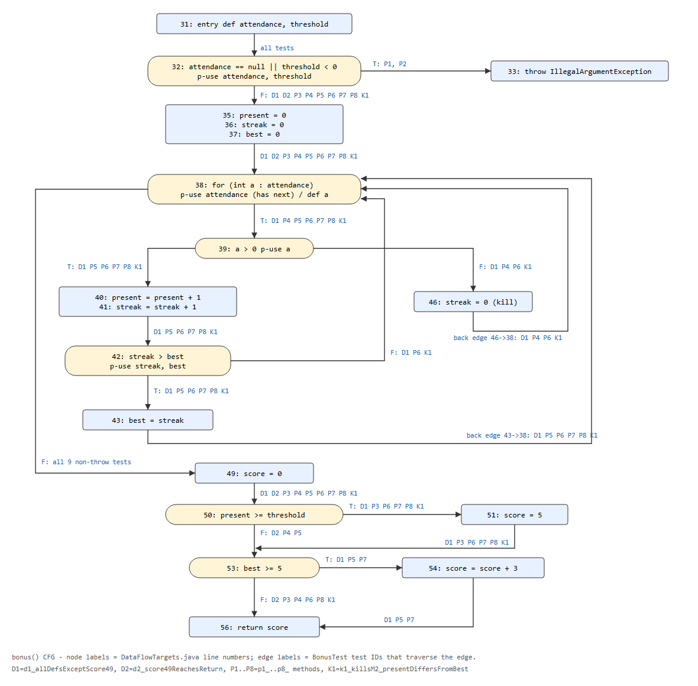

# Лаб 10 — Өгөгдлийн урсгалын тест: Definition-Use хосууд

**Овог нэр:** Г.Хосбаяр
**Оюутны код:** B210910020

### `java -version`

```
openjdk version "17.0.17" 2025-10-21
OpenJDK Runtime Environment Temurin-17.0.17+10 (build 17.0.17+10)
OpenJDK 64-Bit Server VM Temurin-17.0.17+10 (build 17.0.17+10, mixed mode, sharing)
```

### `mvn -version`

```
Apache Maven 3.9.9 (8e8579a9e76f7d015ee5ec7bfcdc97d260186937)
Maven home: C:\Users\gkhos\tools\apache-maven-3.9.9
Java version: 17.0.17, vendor: Eclipse Adoptium, runtime: C:\Program Files\Eclipse Adoptium\jdk-17.0.17.10-hotspot
Default locale: en_US, platform encoding: Cp1252
OS name: "windows 11", version: "10.0", arch: "amd64", family: "windows"
```

Орчин: Windows 11 + Git Bash (`tee` нь UTF-8 бичдэг тул results/ файлуудыг Git Bash-аар хадгалсан).

Мөрийн дугаар бүр `src/main/java/mn/edu/must/sqat/DataFlowTargets.java` файлын мөр. p-use-ийг `(def, (шийдвэрийн мөр, дараагийн мөр))` хэлбэрээр, T/F салаагаар бичсэн.

---

## Хэсэг A — `gcd`

### Def / Use

| Мөр | Код | def | c-use | p-use |
|---|---|---|---|---|
| 13 | `gcd(int x, int y)` | x, y | | |
| 15 | `while (y != 0)` | | | y |
| 16 | `tmp = x % y` | tmp | x, y | |
| 17 | `x = y` | x | y | |
| 18 | `y = tmp` | y | tmp | |
| 20 | `return x` | | x | |

### DU хосын бүрэн хүснэгт (13 хос)

| # | Хувьсагч | Def | Use | Төрөл | Def-clear зам | Тестийн ID | Хамрагдсан |
|---|---|---|---|---|---|---|---|
| 1 | x | 13 | 16 | c-use | 13→15(T)→16 | G2, G3, G4 | ✔ |
| 2 | x | 13 | 20 | c-use | 13→15(F)→20 | **G1 ганцаараа** | ✔ |
| 3 | x | 17 | 16 | c-use | 17→18→15(T)→16 (2+ давталт) | G3 | ✔ |
| 4 | x | 17 | 20 | c-use | 17→18→15(F)→20 | G2, G3, G4 | ✔ |
| 5 | y | 13 | (15,16) | p-use T | 13→15(T) | G2, G3, G4 | ✔ |
| 6 | y | 13 | (15,20) | p-use F | 13→15(F) | **G1 ганцаараа** | ✔ |
| 7 | y | 13 | 16 | c-use | 13→15(T)→16 | G2, G3, G4 | ✔ |
| 8 | y | 13 | 17 | c-use | 13→15(T)→16→17 | G2, G3, G4 | ✔ |
| 9 | y | 18 | (15,16) | p-use T | 18→15(T) (2+ давталт) | G3 | ✔ |
| 10 | y | 18 | (15,20) | p-use F | 18→15(F) | G2, G3, G4 | ✔ |
| 11 | y | 18 | 16 | c-use | 18→15(T)→16 (2+ давталт) | G3 | ✔ |
| 12 | y | 18 | 17 | c-use | 18→15(T)→16→17 (2+ давталт) | G3 | ✔ |
| 13 | tmp | 16 | 18 | c-use | 16→17→18 | G2, G3, G4 | ✔ |

> Тэмдэглэл: 13-р хос нь tmp-ийн цорын ганц хос: tmp-ийг мөр 16-д үргэлж шинээр тодорхойлдог тул 16-аас өөр def-ээс 18 рүү зам байхгүй. Нийт 13 хос (x: 4, y: 8, tmp: 1); бүгд биелэх боломжтой.

Kill: давталтын бие дотор 17 нь x-ийн 13-р def-ийг, 18 нь y-ийн 13-р def-ийг алдаг. Тиймээс эхний давталтын дараа 15/16/17/20-д хүрэх x, y нь заавал 17, 18-ын def байна.

### Тестүүд (`GcdTest.java`)

| ID | Дуудлага | Хүлээгдэх | Давталт | Хамрах хосууд |
|---|---|---|---|---|
| G1 | `gcd(7,0)` | 7 | 0 | x(13,20), y(13,(15,20)) |
| G2 | `gcd(5,5)` | 5 | 1 | x(13,16), x(17,20), y(13,(15,16)), y(13,16), y(13,17), y(18,(15,20)), tmp(16,18) |
| G3 | `gcd(12,8)` | 4 | 2 | x(17,16), y(18,(15,16)), y(18,16), y(18,17) + G2-ийн хосууд |
| G4 | `gcd(0,5)` | 5 | 1 | x=0 хилийн утга; G2-тэй ижил хосууд |

Зааврын асуултууд:
- **`gcd(7,0)`** нь x(13,20) ба y(13,(15,20)) хосыг ГАНЦААРАА хамардаг: зөвхөн y=0 оролт давталтад орохгүйгээр 13-аас шууд 20 рүү очдог.
- **`gcd(12,8)`** нь 2 давталт хийдэг (12%8=4 → (8,4); 8%4=0 → (4,0)). x(17,16), y(18,(15,16)), y(18,16), y(18,17) гэсэн давталтаар дамжих 4 хос **хамгийн багадаа 2 давталт** шаарддаг. Нэг давталттай тест (G2) тэдгээрийг хамарч чадахгүй.
- all-DU-pairs-д G1 + G3 хангалттай; G2, G4-ийг тодорхой байдал, хилийн утгад зориулж нэмсэн.

---

## Хэсэг B — `bonus`

### B1 — CFG



Зангилаа бүр файлын мөрийн дугаартай, ирмэг бүр түүгээр дайрдаг BonusTest-ийн тестийн ID-тай (D1 = `d1_allDefsExceptScore49`, D2 = `d2_score49ReachesReturn`, P1…P8 = `p1_…p8_`, K1 = `k1_killsM2_presentDiffersFromBest`). For-each (38): нөхцөл = attendance-д дараагийн элемент бий эсэх (attendance-ийн p-use), T салаа = a-д дараагийн элементийг оноох (a-ийн def).

### B2 — Def / Use жагсаалт

```java
// 31: def attendance, def threshold                      (параметрүүд)
// 32: p-use attendance, p-use threshold                  (|| short-circuit: attendance==null үед threshold үнэлэгдэхгүй)
// 33: —                                                  (throw)
// 35: def present
// 36: def streak
// 37: def best
// 38: p-use attendance (дараагийн элемент бий юу), def a (T салаанд)
// 39: p-use a
// 40: c-use present, def present
// 41: c-use streak,  def streak
// 42: p-use streak, p-use best
// 43: c-use streak,  def best
// 46: def streak                                          (KILL — доор үз)
// 49: def score
// 50: p-use present, p-use threshold
// 51: def score
// 53: p-use best
// 54: c-use score,   def score
// 56: c-use score
```

### B3 — DU хүснэгт

| # | Хувьсагч | Def | Use | Төрөл | Def-clear замын жишээ | Тестийн ID | Хамрагдсан |
|---|---|---|---|---|---|---|---|
| 1 | attendance | 31 | (32,33) | p-use T | 31→32(T) | P1 | ✔ |
| 2 | attendance | 31 | (32,35) | p-use F | 31→32(F) | D1 (бүх throw-гүй тест) | ✔ |
| 3 | attendance | 31 | (38,39) | p-use T | 31→32→35..37→38(T) | D1 | ✔ |
| 4 | attendance | 31 | (38,49) | p-use F | 31→…→38(F) | D2, P3 | ✔ |
| 5 | threshold | 31 | (32,33) | p-use T | 31→32(T), `threshold<0` үнэлэгдсэн | **P2** (P1-д short-circuit тул threshold уншигдахгүй) | ✔ |
| 6 | threshold | 31 | (32,35) | p-use F | 31→32(F) | D1 | ✔ |
| 7 | threshold | 31 | (50,51) | p-use T | 31→…→50(T) | D1, P3 | ✔ |
| 8 | threshold | 31 | (50,53) | p-use F | 31→…→50(F) | D2 | ✔ |
| 9 | present | 35 | 40 | c-use | 35→…→38→39(T)→40 | D1 | ✔ |
| 10 | present | 35 | (50,51) | p-use T | 35→…→38(F)→49→50(T) (ирсэн өдөргүй, threshold=0) | P3 | ✔ |
| 11 | present | 35 | (50,53) | p-use F | 35→…→38(F)→49→50(F) | D2, P4 | ✔ |
| 12 | present | 40 | 40 | c-use | 40→41→42→(43)→38→39(T)→40 | D1, P5 | ✔ |
| 13 | present | 40 | (50,51) | p-use T | 40→…→38(F)→49→50(T) | D1, P6 | ✔ |
| 14 | present | 40 | (50,53) | p-use F | 40→…→38(F)→49→50(F) | P5 | ✔ |
| 15 | streak | 36 | 41 | c-use | 36→37→38→39(T)→40→41 | D1 | ✔ |
| 16 | streak | 41 | 41 | c-use | 41→42→(43)→38→39(T)→40→41 (дараалсан ирц) | D1, P5 | ✔ |
| 17 | streak | 41 | (42,43) | p-use T | 41→42(T) | D1 | ✔ |
| 18 | streak | 41 | (42,38) | p-use F | 41→42(F) | D1, P6 | ✔ |
| 19 | streak | 41 | 43 | c-use | 41→42(T)→43 | D1 | ✔ |
| 20 | streak | 46 | 41 | c-use | 46→38→39(T)→40→41 (тасалсны дараа ирэх) | D1, P6 | ✔ |
| 21 | best | 37 | (42,43) | p-use T | 37→38→39(T)→40→41→42(T) | D1 | ✔ |
| 22 | best | 37 | (42,38) | p-use F | — | — | ✘ **биелэшгүй** |
| 23 | best | 37 | (53,54) | p-use T | — | — | ✘ **биелэшгүй** |
| 24 | best | 37 | (53,56) | p-use F | 37→38(F)→49→50→53(F) | D2, P3, P4 | ✔ |
| 25 | best | 43 | (42,43) | p-use T | 43→38→39(T)→40→41→42(T) | P5 | ✔ |
| 26 | best | 43 | (42,38) | p-use F | 43→38→39(F)→46→38→39(T)→40→41→42(F) | D1, P6 | ✔ |
| 27 | best | 43 | (53,54) | p-use T | 43→…→53(T) (best ≥ 5) | D1, P5 | ✔ |
| 28 | best | 43 | (53,56) | p-use F | 43→…→53(F) (1 ≤ best < 5) | P6, P8 | ✔ |
| 29 | a | 38 | (39,40) | p-use T | 38→39(T) | D1 | ✔ |
| 30 | a | 38 | (39,46) | p-use F | 38→39(F) | D1, P4 | ✔ |
| 31 | score | 49 | 54 | c-use | 49→50(F)→53(T)→54 (present < thr, best ≥ 5) | P5 | ✔ |
| 32 | score | 49 | 56 | c-use | 49→50(F)→53(F)→56 | D2 | ✔ |
| 33 | score | 51 | 54 | c-use | 51→53(T)→54 | D1, P7 | ✔ |
| 34 | score | 51 | 56 | c-use | 51→53(F)→56 | P3, P6 | ✔ |
| 35 | score | 54 | 56 | c-use | 54→56 | D1 | ✔ |

**Нийт 35 хос: 33 биелэх боломжтой, бүгд хамрагдсан; 2 биелэшгүй.**

**Биелэшгүй хосуудын үндэслэл:**
- **#22 best(37,(42,38)) F салаа:** 42-т хүрэх бүх зам 41-ээр (streak = streak + 1) дамждаг тул streak ≥ 1 байна. best-ийн 37-ийн def (=0) хэвээр байгаа эхний удаад `streak > best` нь `≥1 > 0` болж үргэлж T, тиймээс F биелэхгүй.
- **#23 best(37,(53,54)) T салаа:** best-ийн 37-ийн def 53-т хүрсэн бол best = 0 хэвээр (43 хэзээ ч биелээгүй), тиймээс `0 >= 5` үргэлж F.

**Kill — мөр 46 (`streak = 0`) аль def-ийг алдаг вэ:** 46 нь streak-ийн **36** ба **41**-ийн def-ийг алдаг. 46-аар дамжих аль ч зам streak-ийн хувьд def-clear биш.
- **36 ба 41 хоёулаа** 46-аар дамжих зам дээр алагдана: жишээ нь 41→42→38→39(F)→**46**→38→39(T)→40→41 нь streak(41,41)-ийн def-clear зам биш. Гэвч дараалсан ирцийн шууд зам байгаа тул (41,41) хос хэвээр DU хос.
- 46 өөрөө 41-ээр алагдана: 46-аас 42/43 рүү очих бүх зам 39(T)→40→**41**-ээр дамжина.

**Kill-ээр тасардаг тул DU хос гэж ТООЦООГҮЙ хослолууд** (бүх зам дээр алагдана):
- streak(36,(42,·)), streak(36,43): 36 ба 42/43-ын хооронд 41 үргэлж биелнэ.
- streak(46,(42,·)), streak(46,43): мөн адил 41 алдаг.
- present(35,50) нь 40 огт биелэхгүй үед (ирсэн өдөргүй) def-clear тул тоолсон. Харин score(49,·) хосуудад 51 ба 54 нь 49-ийг алж болох ч 51-гүй зам байгаа тул #31, #32 хос хэвээр.

### B4 — Тестүүд хоёр шатаар (`BonusTest.java`)

**1-р шат — ALL-DEFS: 2 тест (D1, D2)** — commit `B: bonus all-defs tests (2)`

| ID | Оролт | Хүлээгдэх | Ямар def-ийг use-д хүргэдэг |
|---|---|---|---|
| D1 | `[1,0,1,1,1,1,1]`, thr=1 | 8 | attendance, threshold(31), present(35→40, 40→50), streak(36→41, 41→41, **46→41**), best(37→42, 43→53), a(38→39), **score(51→54)**, score(54→56) |
| D2 | `[]`, thr=1 | 0 | **score(49→56)** |

**Яагаад 2-оос цөөн болохгүй вэ:** score-ийн 49-ийн def use-д (54 эсвэл 56) хүрэхийн тулд 51 биелэх ёсгүй, өөрөөр хэлбэл `present < threshold` байх ёстой. Харин score-ийн 51-ийн def үүсэхийн тулд `present >= threshold` байх ёстой. Энэ хоёр нөхцөл нэг гүйцэтгэлд зэрэг үнэн байж чадахгүй, тиймээс score-ийн 49 ба 51-ийн def-ийг нэг тестээр use-д хүргэх боломжгүй. Үлдсэн бүх def-ийг (46 нь тасалсны дараа ирэх, 43 нь 53-т хүрэх гэх мэт) D1 нэг дор хангана.

**2-р шат — ALL-DU-PAIRS: +8 тест (P1–P8)** — commit `B: bonus all-DU-pairs tests (P1-P8)`

| ID | Оролт | Хүлээгдэх | Голчлон нэмж хамрах хосууд |
|---|---|---|---|
| P1 | `null`, thr=1 | IAE | #1 |
| P2 | `[1]`, thr=-1 | IAE | #5 |
| P3 | `[]`, thr=0 | 5 | #4, #7, #10, #24, #34 |
| P4 | `[0,0,0]`, thr=1 | 0 | #11, #30 (бүгд тасалсан) |
| P5 | `[1,1,1,1,1]`, thr=6 | 3 | #14, #25, #27, **#31 score(49,54)** |
| P6 | `[1,0,1,1]`, thr=2 | 5 | #13, #18, #20, #26, #28, #34 (цуваа дунд нь тасарна) |
| P7 | `[1,1,1,1,1,1]`, thr=3 | 8 | #33 (5-аас урт цуваа) |
| P8 | `[1,1,1]`, thr=3 | 5 | present == threshold хил, #28 |

### B5 — JaCoCo

| Шат | Tests run | Branch (covered/total) | BRANCH_MISSED | Line (covered/total) | LINE_MISSED | Эх файл |
|---|---|---|---|---|---|---|
| all-defs | 6 | 14/16 | 2 | 22/24 | 2 | `results/mvn-verify-alldefs.txt`, `results/jacoco-alldefs.csv` |
| final | 15 | **16/16** | **0** | 23/24 | 1 | `results/mvn-verify-final.txt`, `results/jacoco-final.csv` |

Final-ын LINE_MISSED = 1 нь 7-р мөрийн далд constructor `DataFlowTargets()` бөгөөд хэвийн. all-defs шатанд мөр 33 (throw) ба тэр constructor хамрагдаагүй байсан.

**all-defs хангагдсан ч branch 100% биш байж болох уу?** Тийм, бидний тохиолдолд яг ийм гарсан: all-defs (D1, D2) байхад Branch 14/16. Мөр 32-ын хоёр T салаа (`attendance == null`, `threshold < 0`) хамрагдаагүй. Учир нь all-defs нь def бүрийг *аль нэг* use-д хүргэхийг л шаарддаг: attendance, threshold-ийн def-ийг 38, 50-ийн use-ээр хангаж болох тул 32-ын T салааг шаарддаггүй.

**Branch 100% болсон үед DU хүснэгтэд хамрагдаагүй хос үлдэж болох уу?** Тийм. Жишээ нь {D1, D2, P1, P2} гэсэн 4 тест нь bonus-ийн бүх 14 branch-ийг хамарна (CFG дээрх ирмэгийн шошгоос шалгаж болно: 38 T/F, 39 T/F, 42 T/F, 50 T/F, 53 T/F, 32-ын хоёр нөхцөлийн T/F). Гэвч дараах хосууд хамрагдаагүй үлдэнэ:
- **score(49,54)** (#31): `present < threshold` болон `best ≥ 5` зэрэг байх тест (P5) байхгүй;
- **score(51,56)** (#34): `present ≥ threshold` болон `best < 5` (P3/P6) байхгүй;
- **present(35,(50,51))** (#10): ирсэн өдөргүй ба threshold = 0 (P3) байхгүй.

Branch хамралт салаа бүрийг *тусад нь* шалгадаг. DU хамралт харин нэг салаанд хийсэн def-ийг дараагийн салааны use-тэй *хослуулахыг* шаарддаг (50-ийн F → 53-ын T). Тиймээс branch 100% нь all-DU-pairs-ийг баталгаажуулдаггүй, энэ бол лекцийн гол баталгаа.

---

## Хэсэг C — Fault seeding

Мутаци бүрийг `DataFlowTargets.java` дээр шууд хийж, `mvn test`-ийг ажиллуулаад, `git restore`-оор буцаасан. Мутаци commit хийгдээгүй (`git diff <Starter> HEAD -- src/main` хоосон).

| № | Мутаци | Төрөл | Tests run | Failures | Унасан тест ба мөр (results/-ээс) | Үр дүн |
|---|---|---|---|---|---|---|
| M1 | мөр 41 `streak = streak + 1` устгах | Missing update | 14 | 3 | `BonusTest.d1_allDefsExceptScore49:25 expected: <8> but was: <5>`<br>`BonusTest.p5_fiveStreakBelowThreshold:63 expected: <3> but was: <0>`<br>`BonusTest.p7_longStreakAboveThreshold:75 expected: <8> but was: <5>` | **Баригдсан** (`results/mvn-test-M1.txt`) |
| M2 | 42–44 → `best = present;` | Wrong variable | 14 | 0 | — | **АМЬД үлдсэн** (`results/mvn-test-M2.txt`) |
| M3 | 48-ын дараа `int total = present + best;` | Dead definition | 14 | 0 | — | **АМЬД үлдсэн** (`results/mvn-test-M3.txt`) |
| M2 + K1 | M2 хэвээр, K1 тест нэмсэн | — | 15 | 1 | `BonusTest.k1_killsM2_presentDiffersFromBest:89 expected: <5> but was: <8>` | **Алагдсан** (`results/mvn-test-M2-kill.txt`) |

**M1:** streak 0-ээс өсөхгүй тул `streak > best` (0 > 0) хэзээ ч үнэн болохгүй, best = 0 хэвээр үлдэж +3 урамшуулал алга болно. best ≥ 5 шаарддаг гурван тест (D1, P5, P7) унасан.

**M2 яагаад all-DU-pairs-ийг давж амьд үлдсэн бэ:** best шинэчлэгдэх мөчид (хуучин код 43) бидний тестүүдэд `present` ба `streak` ихэнхдээ **тэнцүү** байсан: P5, P7, P8 нь бүгд дараалсан ирцтэй тул present == streak. Ялгаатай байсан тестүүдэд (D1: best 5 → 6, P6: best 2 → 3) буруу утга шийдвэр 53-ын үр дүнг (≥ 5 эсэх) өөрчлөөгүй: D1-д хоёулаа ≥ 5, P6-д хоёулаа < 5. Тиймээс буруу утга үүссэн ч (infection) гаралт хүртэл тархаагүй (propagation). DU хамралт нь "def-ээс use хүртэлх зам биелсэн" гэдгийг л баталдаг, use-д ирсэн *утга* гаралтыг өөрчлөх эсэхийг баталдаггүй.

**M2-ийг унагасан тест K1:** `bonus([1,1,1,0,1,1], 1)` → хүлээгдэх 5. Энд present = 5, харин хамгийн урт цуваа best = 3. Мутантад best = present = 5 болж 53(T) руу орж 8 буцаана. Зорилго нь present ≠ streak бөгөөд тэр ялгаа 5-ын хилийг давах тест.

**M3 яагаад ямар ч тест унагаагүй вэ:** `total` нь def хийгдэж огт use хийгдэхгүй (def-use хосгүй үхсэн def). Гаралтад нөлөөлөхгүй тул динамик тест, гаралтыг шалгадаг assert үүнийг барих боломжгүй. `javac` ч анхааруулдаггүй: мутантыг `javac -encoding UTF-8 -Xlint:all`-аар хөрвүүлэхэд exit code 0, ямар ч warning гараагүй. Үүнийг **статик анализ** барина: IDE-ийн inspection, SonarLint (S1481 unused local variable, S1854 dead store), PMD (`UnusedLocalVariable`), SpotBugs (`DLS_DEAD_LOCAL_STORE`).

IDE-ийн анхааруулга:
> VS Code (Extension Pack for Java), мөр 49 `int total = present + best;` дээр:
> `The value of the local variable total is not used Java(536870973)`

---

## Дүгнэлт

DU анализ нь branch хамралтаас илүү: тэр нь салаа бүрийг тусад нь биш, нэг цэгт хийсэн def-ийг өөр салаа дахь use-тэй хослуулж шалгадаг. Үүний жишээ нь branch 100% байхад ч score(49,54), score(51,56) хамрагдаагүй үлдэж болох явдал. Мөн kill-ийг (мөр 46, 41) ил гаргаж, хаана утга "алдагддаг"-ийг ойлгуулдаг. Гэвч DU анализ үнэтэй: JaCoCo үүнийг хэмждэггүй тул def/use жагсаалт, def-clear зам, биелэшгүй хосын үндэслэлийг бүгдийг гараар хийх хэрэгтэй болдог. bonus-ийн 7 хувьсагчид 35 хос гарсан. Fault seeding нь хамралтын бас нэг хязгаарыг харуулсан: all-DU-pairs хангагдсан ч M2 амьд үлдсэн, учир нь хамралт нь буруу утга гаралтад хүрэхийг баталдаггүй. M3 мэт үхсэн def-ийг тест бус статик анализ л барина. Хамгийн их цаг авсан алхам нь B3 (bonus-ийн DU хүснэгт): for-each давталт ба kill-ийн улмаас def-clear замыг хос бүрд нягталж, биелэшгүй хосыг үндэслэх.

---

## AI туслахын хэрэглээ

Энэ лабыг хийхэд Claude Code (Anthropic) AI туслахыг ашигласан: тестийн код (GcdTest), DU хүснэгтийн анхны ноорог, CFG зургийг үүсгэх скрипт, README-ийн ноорог.
